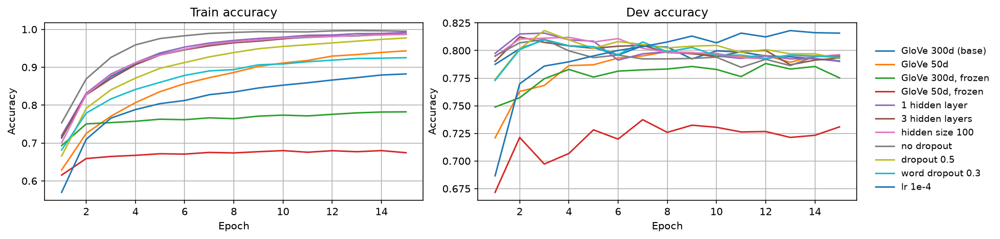
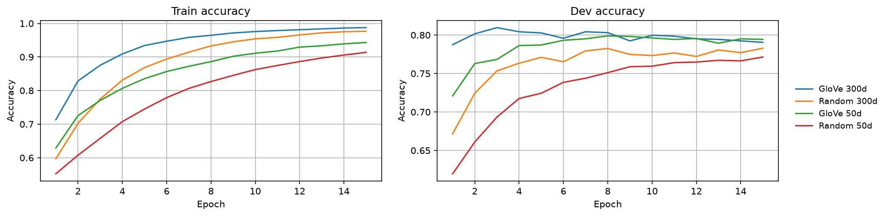
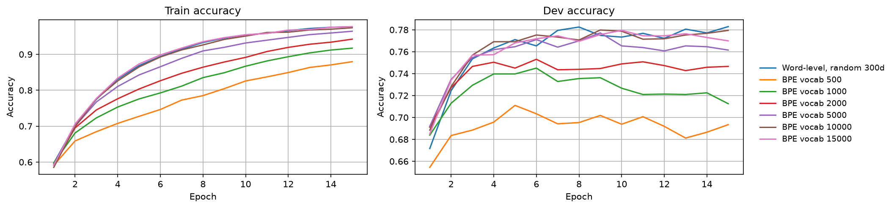

# Deep Averaging Networks | Byte Pair Encoding | Skip-Gram

**Thanh Trinh** · TSS: 200197841 · CSE 256 PA1, Fall 2026

## 1. Methods and Experimental Setup

### 1.1 Approach

I started from the provided bag-of-words pipeline (about 0.71 dev accuracy) and kept its training loop, loss and
evaluation, changing only the input representation and the model. The plan was to (1) build a word-level DAN on
pretrained GloVe embeddings and tune it well past 77%, (2) change one design choice at a time to see which ones
matter (1a), (3) replace GloVe with randomly initialized embeddings (1b), and (4) replace word tokens with BPE
subwords (Part 2). Steps 3 and 4 use the same classifier and training setup, so accuracy differences come from the
input representation alone. Part 3 was solved analytically, and the answers were checked numerically.

### 1.2 Implementation

- **DAN** (`DANmodels.py`). Each sentence becomes a list of token indices (unknown words map to `UNK`, whose GloVe
  vector starts at zero), padded with `PAD` (index 0) within a batch. The embeddings are averaged over real tokens
  only, using a padding mask, so the representation does not depend on how much padding the batch needs. The
  average goes through dropout, then hidden layers (Linear → ReLU → dropout), then a Linear layer to 2 classes and
  a log-softmax, trained with `NLLLoss`. The embedding layer comes from
  `get_initialized_embedding_layer(frozen=False)`, so GloVe is fine-tuned. I also implemented the *word dropout* of
  Iyyer et al.: during training each token is removed from the average with probability *p*, but at least one
  token per sentence is always kept.
- **BPE** (`bpe.py`). Following Sennrich et al., each training word is split into characters, with an end-of-word
  marker attached to the last one (`low` → `l o w</w>`) so suffixes are distinguished from word pieces. The most
  frequent adjacent pair (weighted by word frequency) is merged repeatedly until the vocabulary reaches the target
  size, or until no pair occurs twice (at 13,368 types on `train.txt`). Pair counts are updated incrementally,
  touching only words that contain the merged pair, so 10,000 merges take about 0.7 seconds. The learned merges
  exactly match a naive implementation that recounts every pair at each step. New text is segmented by applying
  the merges in the order they were learned. The subword DAN reuses the DAN above with randomly initialized
  embeddings.
- **Training** (`main.py`, `run_experiments.py`). Adam, `NLLLoss`, and train/dev loss and accuracy printed every
  epoch. `run_experiments.py` runs every experiment in this report.

### 1.3 Experimental setup

- **Data:** 6,920 training and 872 dev sentences (binary sentiment, lowercased by the provided reader). All results
  are on dev.
- **Training:** Adam, batch size 32, 15 epochs, on a laptop CPU. Times are training time only.
- **Reporting:** every configuration was run with 3 seeds. Tables report mean ± std of *best* dev accuracy (the
  highest over the 15 epochs) and *final* dev accuracy (after epoch 15).
- **Ablations:** each ablation changes one setting of a base model: fine-tuned 300d GloVe, 2 hidden layers of
  300, ReLU, dropout 0.3, lr 1e-3.

### 1.4 Hyperparameters and designs explored

| Setting | Values tried | Chosen |
|---|---|---|
| Embeddings | GloVe 300d/50d, random 300d/50d | GloVe 300d |
| Embedding updates | fine-tuned, frozen | fine-tuned |
| Hidden layers × size | 1, 2, 3 layers × 100, 300 | 2 × 300 |
| Dropout / word dropout | 0, 0.3, 0.5 / 0, 0.3 | 0.3 / 0 |
| Learning rate | 1e-3, 1e-4 | 1e-4 (300d GloVe), 1e-3 (others) |
| BPE vocabulary size | 500, 1k, 2k, 5k, 10k, 15k | 10k |

The best learning rate depends on the model. Lowering it to 1e-4 is the most effective change for fine-tuning
300d GloVe (Section 2.1). For 50d GloVe, 1e-4 is too slow to converge in 15 epochs: a run at 1e-4 reaches only
0.753, versus 0.794 ± 0.004 at 1e-3. `main.py` therefore defaults to 1e-4 only for the 300d GloVe DAN, and
trains the 50d, random-embedding and subword models at 1e-3.

## 2. Results and Discussion

### 2.1 Part 1a: DAN with GloVe embeddings

**Final model:** fine-tuned 300d GloVe, 2 hidden layers of 300, ReLU, dropout 0.3, lr 1e-4, 15 epochs. It reaches
**0.816 ± 0.001** final dev accuracy (0.819 best) in about 33 seconds of training, well above the 77% target and
the bag-of-words baselines (0.71 for 2 layers, 0.69 for 3 layers).

**Ablations** (each row changes one setting of the base model, Section 1.3):

| Configuration | Best dev | Final dev | Final train | Time (s) |
|---|---|---|---|---|
| Base (300d GloVe, lr 1e-3) | 0.813 ± 0.000 | 0.791 ± 0.011 | 0.987 | 33 |
| **lr 1e-4** | **0.819 ± 0.001** | **0.816 ± 0.001** | 0.882 | 32 |
| 50d GloVe | 0.803 ± 0.004 | 0.794 ± 0.004 | 0.943 | 9 |
| 300d GloVe, frozen | 0.790 ± 0.001 | 0.775 ± 0.006 | 0.782 | 6 |
| 50d GloVe, frozen | 0.740 ± 0.002 | 0.731 ± 0.008 | 0.674 | 4 |
| 1 hidden layer | 0.817 ± 0.001 | 0.790 ± 0.002 | 0.992 | 33 |
| 3 hidden layers | 0.813 ± 0.004 | 0.793 ± 0.008 | 0.987 | 35 |
| Hidden size 100 | 0.818 ± 0.002 | 0.796 ± 0.005 | 0.987 | 31 |
| No dropout | 0.816 ± 0.006 | 0.795 ± 0.010 | 0.995 | 32 |
| Dropout 0.5 | 0.818 ± 0.007 | 0.793 ± 0.010 | 0.977 | 33 |
| Word dropout 0.3 | 0.812 ± 0.001 | 0.794 ± 0.004 | 0.925 | 33 |

**Observations.**

- **Every fine-tuned configuration clears 77%.** The DAN beats the bag-of-words baseline by about 10 points,
  because pretrained embeddings let it generalize to words that are rare in the 6,920 training sentences.
- **Overfitting is the main issue.** At lr = 1e-3 dev accuracy peaks within 2–6 epochs and then declines while
  training accuracy approaches 99%. The embedding matrix (about 4.5M parameters at 300d) can memorize the small
  training set. Lowering the learning rate to 1e-4 was the most effective change: dev accuracy rises steadily and
  stays near its peak (best 0.819, final 0.816, with the lowest variance across seeds).
- **Fine-tuning matters.** Freezing the embeddings costs 2.3 points at 300d and 6.3 points at 50d. Frozen models
  underfit (final train accuracy 0.67–0.78): GloVe's general-purpose vectors are not tuned for sentiment, for
  example "good" and "bad" have similar contexts and therefore similar vectors. 300d is more robust than 50d,
  especially when frozen, since the extra dimensions leave more room for sentiment-relevant directions.
- **Architecture changes have little effect.** Depth (1–3 layers), hidden size (100 vs. 300) and standard dropout
  (0–0.5) all move best dev accuracy by under 0.6 points, within about one standard deviation. Dropout and word
  dropout reduce training accuracy (word dropout: 0.925 vs. 0.987) but do not improve dev accuracy at lr = 1e-3,
  because the overfitting comes mostly from the embedding updates.

### 2.2 Part 1b: Randomly initialized embeddings

For random initialization, the vocabulary is built from the training set (`PAD`, `UNK` and every training word,
14,832 types) and the embeddings are drawn from N(0, 1) by `nn.Embedding`. Dev words that never appear in training
(5.7% of dev tokens) map to `UNK`; otherwise their random vectors would never be updated and would add pure noise
to the average. Everything else matches the base model (lr 1e-3, 15 epochs).

| Embeddings | Best dev | Final dev | Final train | Epoch of best dev |
|---|---|---|---|---|
| GloVe 300d | 0.813 ± 0.000 | 0.791 ± 0.011 | 0.987 | 5.7 |
| Random 300d | 0.786 ± 0.004 | 0.783 ± 0.003 | 0.977 | 10.7 |
| GloVe 50d | 0.803 ± 0.004 | 0.794 ± 0.004 | 0.943 | 9.0 |
| Random 50d | 0.776 ± 0.012 | 0.771 ± 0.013 | 0.914 | 14.7 |

**Discussion.** Random embeddings still reach about 78–79% at 300d (just above the 77% target), but they are
2.7 points worse than GloVe at the peak, and the effect on convergence is clear:

- **Slower convergence.** With GloVe the first epoch already gives about 76% dev accuracy, because similar words
  start with similar vectors and the network only has to learn a classifier on top. With random vectors every word
  starts unrelated to every other, and sentiment information has to reach each embedding through the gradients of
  the sentences it appears in. Best dev accuracy arrives at epoch 10.7 instead of 5.7 (300d), and at 50d the model
  is still improving at epoch 15.
- **Worse generalization.** A word seen once or twice in training gets only a few noisy updates, and unseen dev
  words collapse to `UNK`. GloVe carries information learned from billions of tokens, so rare and unseen-in-train
  words still contribute a useful signal.
- **Higher variance.** Random 50d has 3× the seed-to-seed standard deviation of GloVe 50d.

### 2.3 Part 2a: Subword DAN with BPE

The subword DAN uses randomly initialized 300d embeddings, lr 1e-3, 15 epochs (BPE implementation in Section 1.2).
Example segmentation with vocabulary size 2000: `unbelievably overwrought` →
`un believ ably</w> over wr ought</w>`.

| Model | Vocab | Tokens / sentence | Best dev | Final dev | Time (s) |
|---|---|---|---|---|---|
| Word-level DAN, random 300d | 14,832 | 19.3 | 0.786 ± 0.004 | 0.783 ± 0.003 | 32 |
| Word-level DAN, GloVe 300d (1a) | 14,923 | 19.3 | 0.819 ± 0.001 | 0.816 ± 0.001 | 32 |
| BPE 500 | 502 | 42.3 | 0.713 ± 0.004 | 0.693 ± 0.002 | 9 |
| BPE 1000 | 1,002 | 35.2 | 0.747 ± 0.006 | 0.713 ± 0.011 | 10 |
| BPE 2000 | 2,002 | 29.9 | 0.761 ± 0.003 | 0.747 ± 0.014 | 11 |
| BPE 5000 | 5,002 | 24.7 | 0.779 ± 0.007 | 0.761 ± 0.002 | 17 |
| BPE 10000 | 10,002 | 21.8 | 0.784 ± 0.006 | 0.779 ± 0.005 | 25 |
| BPE 15000 (all merges) | 13,368 | 20.8 | 0.786 ± 0.002 | 0.770 ± 0.005 | 32 |

**Discussion.**

- **Accuracy increases with vocabulary size.** Accuracy rises from 0.713 at 500 subwords to 0.784–0.786 at
  10k–13k, which matches the word-level DAN with random embeddings (0.786). Small vocabularies break words into
  short fragments (42 tokens per sentence at 500, versus 19 words). With 500 subwords, "brilliant" becomes
  `br il li ant</w>` and "masterpiece" becomes `ma st er pi ec e</w>`. Since a DAN averages its inputs without
  word order, it cannot recombine such fragments into the meaning of the whole word.
  Fragments shared by many unrelated words carry little sentiment of their own, and averaging dilutes the
  informative ones.
- **Large vocabularies converge to word level.** At 10k+ merges almost every frequent word is a single token, so
  the model behaves like the word-level DAN. The subword model never beats word level on this data, but it gets
  close with fewer parameters (10k vs. 14.8k embeddings).
- **BPE removes unknown words.** The word-level model maps 5.7% of dev tokens to `UNK`, while BPE segments almost
  everything into known pieces (only 3 dev tokens contain unseen characters). On this in-domain data the benefit
  is small, since most OOV words are numbers and names (`1873`, `87-minute`, `abrams`) that carry little
  sentiment.
- **Efficiency trade-off.** A smaller vocabulary means a smaller embedding table (500 × 300 = 150k parameters vs.
  4M at 13k) and much faster training (9s vs. 32s for 15 epochs, since the dense embedding gradient and Adam
  update touch the whole table every step), even though sentences become twice as long. Training BPE itself is negligible
  (< 1s).
- **Neither matches GloVe.** All random-initialization models trail the GloVe DAN (0.816) by 3+ points.
  Pretraining matters more than the choice of token unit on a dataset this small.

## 3. Part 3: Understanding Skip-Gram

### Q1

With window *k* = 1, the sentences "the dog", "the cat", "a dog" give the training pairs
(the, dog), (dog, the), (the, cat), (cat, the), (a, dog), (dog, a).

**3a)** The center word *the* appears in two training examples, with contexts *dog* and *cat*. Maximum likelihood
matches the empirical distribution, so

P(dog | the) = 1/2, P(cat | the) = 1/2, P(a | the) = 0, P(the | the) = 0.

**3b)** Yes. The context vectors are c_dog = c_cat = (0, 1) and c_a = c_the = (1, 0). Take **v_the = (0, 10)**,
so v_the · c_dog = v_the · c_cat = 10 and v_the · c_a = v_the · c_the = 0. Then
P(dog | the) = e¹⁰ / (2e¹⁰ + 2e⁰) = 22026.5 / 44055 ≈ **0.49998** = P(cat | the), and
P(a | the) = P(the | the) = 1 / 44055 ≈ **0.00002**.

These are within 0.01 of the optimum (1/2, 1/2, 0, 0).

*Why it is optimal:* the target puts equal mass on *dog* and *cat*, which share a context vector, so any v_the
automatically scores them equally. The only remaining goal is to make *a* and *the* negligible, which means making
the second coordinate of v_the much larger than the first. As the scale grows (v_the = (0, t), t → ∞), the
probabilities approach exactly (1/2, 1/2, 0, 0). The exact optimum needs infinite weights; t = 10 already gets
within 2 × 10⁻⁵. (Any t ≥ 4 gets within 0.01; v_the = (−10, 10) is even closer.)

### Q2

**3c)** Sentences "the dog", "the cat", "a dog", "a cat" with *k* = 1 give 8 training examples (x, y):

(the, dog), (dog, the), (the, cat), (cat, the), (a, dog), (dog, a), (a, cat), (cat, a)

**3d)** The empirical (optimal) conditionals are P(dog | the) = P(cat | the) = P(dog | a) = P(cat | a) = 1/2 and
P(the | dog) = P(a | dog) = P(the | cat) = P(a | cat) = 1/2, with all other probabilities 0.

Determiners predict nouns and nouns predict determiners, so we put the two groups on orthogonal axes:

| Word | Word vector v | Context vector c |
|---|---|---|
| the | (0, 10) | (1, 0) |
| a | (0, 10) | (1, 0) |
| dog | (10, 0) | (0, 1) |
| cat | (10, 0) | (0, 1) |

Check:

- v_the · c_dog = v_the · c_cat = 10 and v_the · c_the = v_the · c_a = 0, so
  P(dog | the) = P(cat | the) = e¹⁰ / (2e¹⁰ + 2) ≈ 0.49998 and P(the | the) = P(a | the) ≈ 0.00002.
  The same holds for *a*.
- v_dog · c_the = v_dog · c_a = 10 and v_dog · c_dog = v_dog · c_cat = 0, so
  P(the | dog) = P(a | dog) ≈ 0.49998 and P(dog | dog) = P(cat | dog) ≈ 0.00002. The same holds for *cat*.

Every conditional is within 2 × 10⁻⁵ of the optimum (well within 0.01), so these vectors nearly maximize the
skip-gram objective. Scaling 10 → ∞ approaches the exact optimum. I also verified these probabilities numerically.
